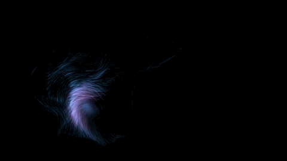
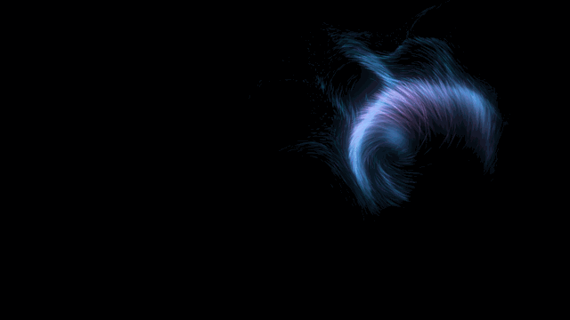
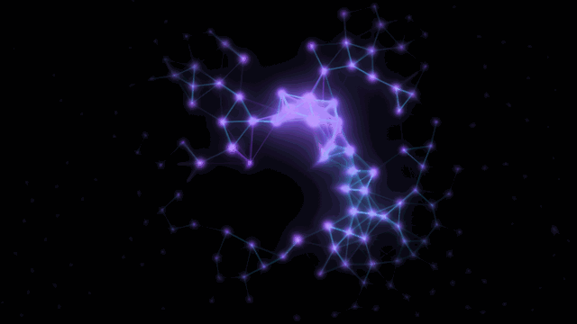
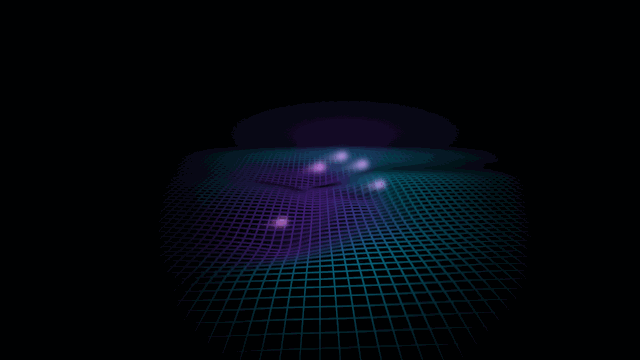
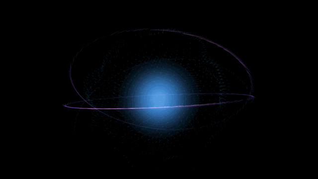
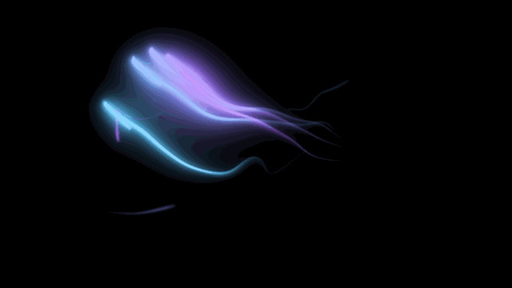
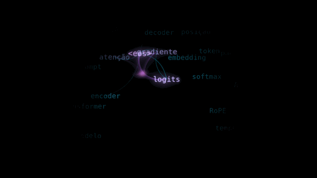
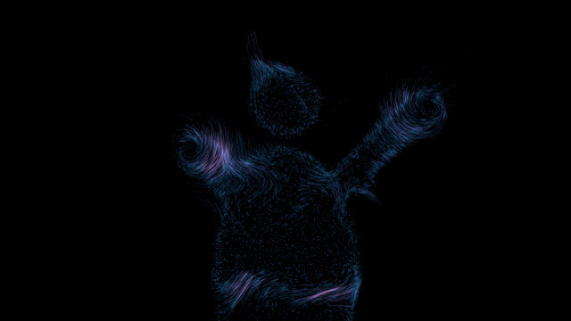
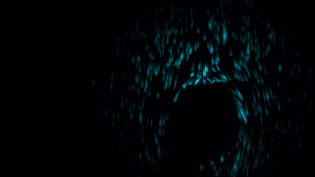

# Neural Tide

[Português](README.md) · **English**

Interactive visual art made with nothing but code. The webcam tracks your hands
and eight tech- and AI-themed effects react to them in real time, moving fluidly,
like ocean waves. Your hand disturbs and influences the effect but never drives it
directly: nothing is "glued" to it. You switch effects with gestures.

Python, MediaPipe, NumPy and GLSL shaders through ModernGL. Runs at 60 FPS on
Windows and macOS.



## The 8 modes

<table>
<tr>
<td width="50%"><br><b>1 · Data tide</b><br>24k particles riding a curl-noise current. Your hand becomes a whirlpool that leaves a wake; a pinch turns it into a drain.</td>
<td width="50%"><br><b>2 · Living neural network</b><br>Nodes linked by proximity. A pinch fires a pulse that hops from node to node like a wave.</td>
</tr>
<tr>
<td><br><b>3 · Holographic grid</b><br>A perspective mesh that is a real 2D wave equation. Your fingertips make the waves.</td>
<td><br><b>4 · AI core</b><br>A breathing sphere of particles held between your hands. Their distance sets the size and your wrist roll spins it.</td>
</tr>
<tr>
<td><br><b>5 · Light ribbons</b><br>Ribbons of light trailing from your five fingertips, swaying like silk in water.</td>
<td><br><b>6 · Attention (LLM)</b><br>Floating tokens. Each hand is a <i>query</i>, and the attention weights (softmax) become arcs of light.</td>
</tr>
<tr>
<td><br><b>7 · Particle body</b><br>Your silhouette (MediaPipe segmentation) becomes digital dust that peels away in waves.</td>
<td><br><b>8 · Liquid code rain</b><br>Glyphs pouring down like a liquid and flowing around your hand like water around a stone.</td>
</tr>
</table>

> The GIFs above are generated by `tools/render_demos.py` with synthetic hands
> following fixed paths, so anyone can reproduce them. With a webcam you can
> record your own with the **R** key (see [Recording and making GIFs](#recording-and-making-gifs)).

## Gestures

| Gesture | Action |
|---|---|
| 1–5 raised fingers, hand still for 0.5 s | go to mode 1–5 |
| Sideways swipe with an open hand | next mode (to the left) / previous (to the right) |
| Pinch (thumb + index) | the current mode's interaction |
| Closed fist | explosion |
| Horns (index + pinky) | next colour palette |
| Distance between both hands | intensity (in mode 4, the size of the core) |
| Open palm held still for 1 s | freeze / unfreeze |

While you hold a gesture, an animated progress ring appears at your fingertip,
with what is about to happen written next to it. When the gesture fires, the ring
bursts and a toast appears at the top of the screen. Modes 6–8 are one swipe away
(or on keys 6–8).

- **Open palm**: five fingers mean both "mode 5" and "freeze", so the hold time
  decides. Release between 0.5 s and 1 s to go to mode 5; hold the full second to
  freeze. The ring shows a tick halfway.
- **Horns vs. two fingers**: index + pinky is always horns, with or without the
  thumb (🤘 and 🤟). "Two fingers" is any other pair.
- **Pinch vs. fist**: a pinch needs the index finger reaching forward, so a thumb
  resting on a fist does not count. Finger counting is ignored while pinching, so
  the "OK" sign 👌 is not "three fingers".
- **Freezing** is never abrupt: simulation time slows down to zero (and speeds back
  up).

## Keys

| Key | Action |
|---|---|
| 1–8 | go to that mode |
| P | next palette (neon, matrix, amber, ice) |
| M | focus on the hands ↔ full screen |
| R | start / stop MP4 recording (`recordings/`) |
| C | background: dimmed camera or black |
| F1 or D | debug overlay (FPS, landmarks, each hand's gesture, timings) |
| ESC | quit |

On Macs F1 usually needs Fn, hence **D**.

## Installation

| Package | Version | Role |
|---|---|---|
| **Python** | **3.12** | the project's official version |
| mediapipe | 1.2.0 | HandLandmarker and ImageSegmenter (Tasks API) |
| opencv-contrib-python | 4.12.0.88 | webcam capture and recording |
| numpy | 2.2.6 | every simulation, vectorised |
| moderngl | 5.13.0 | GPU rendering (OpenGL 3.3) |
| pygame-ce | 2.5.8 | window, keyboard and mouse |
| pillow (dev) | 13.0.0 | README GIFs |

Supported systems: **Windows 10/11** (64-bit) and **macOS on Apple Silicon**.
mediapipe 1.x only ships macOS wheels for arm64, so Intel Macs are not supported.

<details>
<summary>Why these versions</summary>

- mediapipe 1.2.0 supports Python 3.9–3.14, and 3.12 has wheels for every
  package above on both systems (3.13 should work too).
- OpenCV comes as `opencv-contrib-python` because that is what mediapipe already
  installs; adding `opencv-python` would install a second, conflicting `cv2`. 4.12
  is the newest release whose macOS wheel does not bundle its own SDL2, which
  clashes with pygame's.
- numpy 2.2 because OpenCV 4.12 requires numpy below 2.3.
</details>

### Windows

```bat
git clone https://github.com/FelipePanini/Neural-Tide.git
cd Neural-Tide
py -3.12 -m venv .venv
.venv\Scripts\activate
pip install -r requirements-dev.txt
python tools/download_model.py
```

### macOS

Install Python 3.12 (from [python.org](https://www.python.org/downloads/), with
`brew install python@3.12` or with `uv python install 3.12`), then:

```bash
git clone https://github.com/FelipePanini/Neural-Tide.git
cd Neural-Tide
python3.12 -m venv .venv
source .venv/bin/activate
pip install -r requirements-dev.txt
python tools/download_model.py
```

`tools/download_model.py` downloads both MediaPipe models into `models/`: the
hand model and the person segmenter used by mode 7.

The first time you use the webcam, macOS asks for camera permission for the app
that launched Python (Terminal, iTerm, VS Code…). If you deny it, enable it later
under **System Settings › Privacy & Security › Camera**. If a nearby iPhone
becomes camera 0 (Continuity Camera), use `--camera 1`.

## Running

| Command | What it does |
|---|---|
| `python main.py` | uses the webcam |
| `python main.py --mock` | the mouse becomes a hand (no webcam needed) |
| `python main.py --camera 1 --size 1920x1080 --fullscreen` | another camera, window size and full screen |
| `pytest` | runs the tests |

**Mock mode**: moving the mouse moves the hand; the mouse wheel, trackpad scroll
or the ↑/↓ arrows change the raised fingers; click to pinch; right button or
**F** makes a fist; **G** makes horns; **H** adds a mirrored second hand; moving
the pointer out of the window takes the hand out of frame. In mode 7 a synthetic
silhouette stands in for the camera.

If the frame rate drops below 30, lower the particle counts in `config.py` (for
example `DataTideConfig.particle_count`).

## Recording and making GIFs

1. Press **R** to start recording and **R** again to stop. The MP4 goes to
   `recordings/` with the effects and the gesture rings, but without the debug
   overlay. Pixels are read back once per video frame and encoded on a separate
   thread, so recording barely affects the frame rate.
2. Turn a section into a GIF:
   ```bash
   python tools/make_gif.py recordings/neural-tide-20261101-120000.mp4 assets/modo-1.gif --start 2 --duration 4
   ```
3. To regenerate the README's synthetic demos: `python tools/render_demos.py`.

## How it works

```
Camera (thread)        HandTracker (thread)         render loop (60+ FPS)
capture + mirror ────► MediaPipe VIDEO        ───►  HandStateSmoother (easing)
                       slots + One Euro             GestureEngine (state machine)
                       PersonSegmenter (thread,     ModeManager → active effect(s)
                       mode 7 only)                 PostFX: trails → bloom → focus → tone map
                                                    gesture UI → recording → debug
```

- **Nothing blocks rendering**: capture, tracking and segmentation run on their
  own threads, and the render loop only reads the newest result.
- **Smooth hands**: a One Euro filter on every landmark (image and 3D). Tracking
  runs at ~30 Hz and rendering at 60+, so every frame also eases the hand towards
  its latest position. Hands fade in and out.
- **Left/right**: the image is mirrored (selfie view). MediaPipe 1.2 labels hands
  as if the picture were not mirrored, so the labels are swapped.
- **Finger counting** uses 3D landmarks in metres, summing each finger's joint
  angles, so it does not depend on distance or hand rotation.
- **Gestures**: a state machine per hand, with an N-frame debounce, holds that
  need a still hand, re-arming only after a pose change, and a global cooldown.
- **Fluid physics**: particles relax towards a field (damped springs on
  velocity) instead of being placed. The noise is vectorised 3D simplex,
  evaluated on a grid and sampled bilinearly.
- **Trails**: the effect layer is an HDR (float16) buffer that is never cleared;
  each frame multiplies the previous one by `exp(-dt/τ)`. Then comes a dual-filter
  bloom and a hue-preserving tone map, so dense neon stays neon instead of turning
  white.
- **Frame-rate independent brightness**: the light that builds up in the trails
  depends on the frame rate, and a per-frame gain cancels it out.
- **Focus on the hands**: gaussian spotlights around each hand mask the effect
  layer at composition time. The simulation still runs on the whole screen; the
  mask only decides what shows.
- **Transitions**: cross-faded opacities plus a liquid ripple that sweeps the
  screen from the hand that made the gesture.

<details>
<summary><b>Per-mode details</b></summary>

- **1 · Data tide**: the curl-noise potential is evaluated on a grid and the
  velocity is its curl, so the flow has no sources or sinks and particles never
  clump. Each hand is a Lamb–Oseen vortex (no singularity at the centre) plus a
  current along its motion; the right hand spins counter-clockwise and the left
  one clockwise. A pinch pulls particles into a ring and a fist kicks them outwards.
  Particles are born and die with a fade, so nothing teleports.
- **2 · Living neural network**: a plexus with soft repulsion. Pulses travel along
  the links at constant speed, lose energy on every hop and respect a refractory
  period, like neurons. Fingertips plug into nearby nodes.
- **3 · Holographic grid**: `h_tt = c²∇²h − damping·h_t` solved with substeps (CFL
  condition) and an absorbing border layer. The camera ray through a fingertip
  meets the plane at the point that finger pushes. The lines come from the
  fragment shader with `fwidth`: constant width and no moiré.
- **4 · AI core**: a Fibonacci sphere with orbit rings, projected in perspective.
  Each particle chases its place with a critically damped spring; a fist loosens
  the springs so the sphere comes apart and reforms.
- **5 · Light ribbons**: each ribbon is a chain of points in which every point
  chases the one ahead, with the tail swaying in a curl-noise field.
- **6 · Attention**: softmax of `−d²/temperature` over each hand's k closest
  tokens. A pinch lowers the temperature and sends sparks along the arcs. The
  words live in a texture atlas drawn as instanced quads.
- **7 · Particle body**: dust is emitted from the segmentation mask (denser along
  the outline), and wave bands travelling up the body decide which dust is
  released. The segmenter only runs while the mode is on screen.
- **8 · Code rain**: each hand is a cylinder in a potential flow
  (`u − iv = iU(1 + R²/z²)`), so the rain parts in front of it and closes behind.
</details>

## Making your own mode

A new mode is **one file in `effects/` plus one line in the registry**. In this
example, glowing orbs follow your fingertips and flash when you pinch.

**1. Parameters in `config.py`** (no magic numbers in the code):

```python
@dataclass(frozen=True)
class OrbsConfig:
    """Example mode: orbs at the fingertips."""

    radius: float = 0.07
    intensity: float = 0.6
    follow_tau_s: float = 0.08
    fade_tau_s: float = 0.2
    pinch_flash: float = 3.0
```

and, in the `Config` class: `orbs: OrbsConfig = field(default_factory=OrbsConfig)`.

**2. The effect, in `effects/orbs.py`:**

```python
"""Example mode: glowing orbs that follow the fingertips."""

from __future__ import annotations

from collections.abc import Sequence

import numpy as np

from core.easing import damp
from core.gestures import GestureEvent, GestureKind
from core.hand_state import HandState
from effects.base import Effect, EffectEnv
from render.glow import GlowBatch


class Orbs(Effect):
    name = "Orbs"

    def __init__(self, env: EffectEnv) -> None:
        super().__init__(env)
        self._cfg = env.config.orbs
        self._glows = GlowBatch(env.ctx, env.shaders, capacity=10)
        self._pos = np.zeros((10, 2))  # 2 hands × 5 fingers, eased
        self._light = np.zeros(10)  # brightness of each orb, eased too

    def update(self, dt: float, hands: Sequence[HandState]) -> None:
        target = np.zeros(10)
        for i, hand in enumerate(hands[:2]):
            rows = slice(5 * i, 5 * i + 5)
            # The orbs chase the fingers instead of sticking to them.
            self._pos[rows] = damp(self._pos[rows], hand.tips, self._cfg.follow_tau_s, dt)
            target[rows] = hand.presence * np.array(hand.fingers, dtype=float)
        self._light = damp(self._light, target, self._cfg.fade_tau_s, dt)

    def on_gesture(self, event: GestureEvent) -> None:
        if event.kind is GestureKind.PINCH_START:
            self._light *= self._cfg.pinch_flash  # pinching makes the orbs flash

    def draw(self) -> None:
        color = np.asarray(self.env.palette.highlight) * self._cfg.intensity * self.visibility
        self._glows.add(self._pos, self._cfg.radius, color[None, :] * self._light[:, None])
        self._glows.flush(self.env.viewport)

    def release(self) -> None:
        self._glows.release()
```

**3. Registration, in `effects/__init__.py`:** import `Orbs` and append it to the
`EFFECTS` list. Its position in the list is its mode number; a ninth mode is one
swipe away.

What your mode gets for free:

| Feature | What it is for |
|---|---|
| `update(dt, hands)` / `draw()` | required. `dt` is already 0 while frozen |
| `hands` | list of `HandState`: `points`, `tips`, `palm`, `velocity`, `fingers`, `pinch`, `presence`, `roll`, `world` |
| `self.visibility` | multiply your brightness by it: includes the cross-fade and frame-rate compensation |
| `self.intensity` | 1 = neutral; follows the distance between both hands |
| `self.env.palette` | the current palette's colours, already eased |
| `on_gesture(event)` | `PINCH_START`, `PINCH_END`, `EXPLODE` |
| `trail()` | how much trail the mode wants (time and diffusion) |
| `focus_scale()`, `focus_strength()`, `focus_spots()` | size and strength of the hand spotlight, plus extra spotlights |
| `needs_segmentation` | `True` turns person segmentation on; the mask comes from `self.env.segmentation()` |
| `GlowBatch`, `ParticleRenderer`, `PrimitiveBatch`, `SpriteBatch` | ready-made lights, particles, lines and text |
| `FlowField`, `vortex`, `suction`, `WaveField` | vectorised fields and forces, in `sim/` |

To see your mode without a webcam: `python main.py --mock`. To test it without a
window, `render/offscreen.py` runs the whole pipeline into a texture (that is what
the tests and the demos use).

## Tests

```bash
pytest
```

120+ tests: One Euro filter, finger counting under random rotations, tracker,
gesture state machine, every mode's simulation, the recorder, and an offscreen
render of every mode. Rendering tests are skipped when OpenGL 3.3 is unavailable.

## Layout

```
main.py              command-line arguments
app.py               main loop
config.py            every tunable value
core/                camera, tracking, One Euro, hands, gestures, segmentation, mock
sim/                 simplex noise, curl noise, forces, wave equation
effects/             one file per mode + base.py, manager.py and the registry
render/              window, post-processing, focus, gesture UI, recording, shaders/
tools/               model download, MP4 → GIF, mode demos
tests/
assets/              README GIFs
```

## Credits and license

Made by [Felipe Panini](https://github.com/FelipePanini). Built with
[MediaPipe](https://ai.google.dev/edge/mediapipe), [ModernGL](https://github.com/moderngl/moderngl),
[pygame-ce](https://pyga.me), [NumPy](https://numpy.org) and [OpenCV](https://opencv.org).
MIT license: see [LICENSE](LICENSE).
