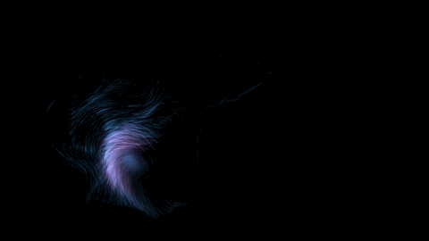
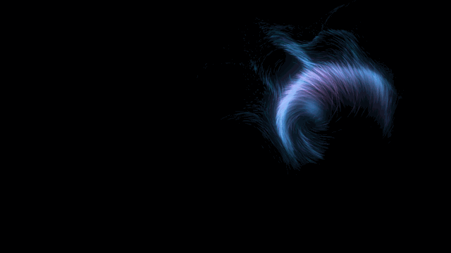
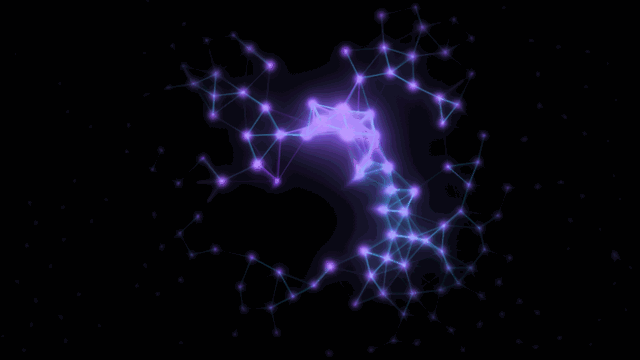
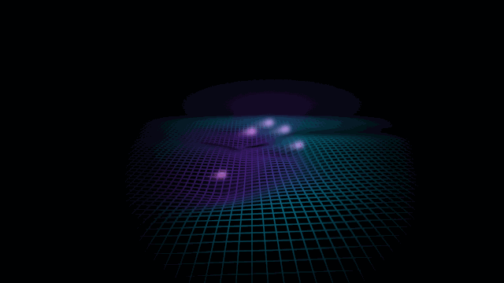
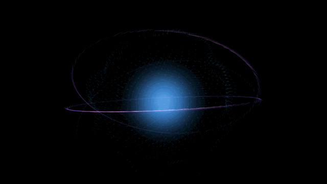
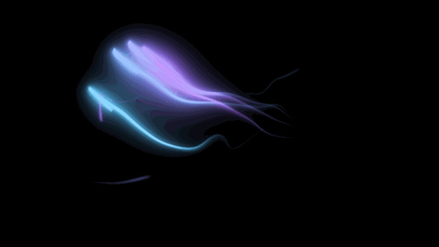
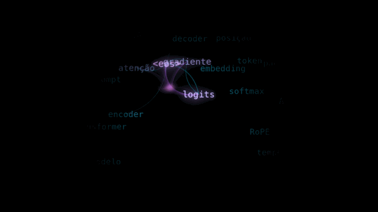
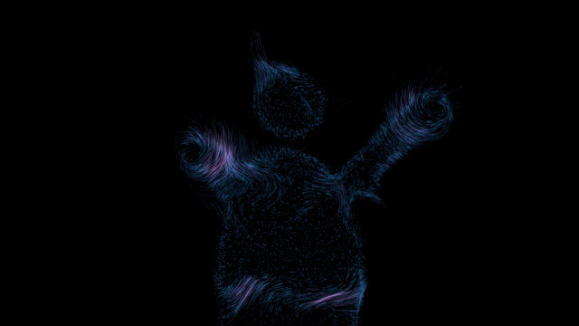
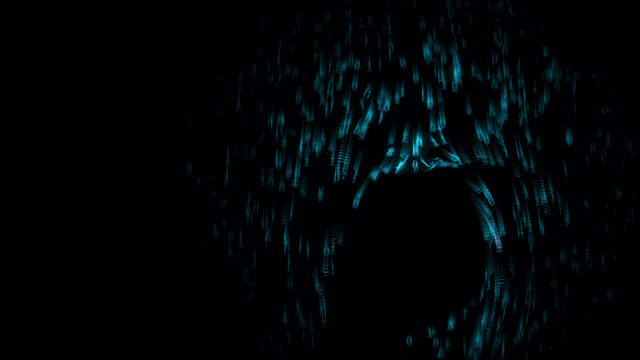

# Neural Tide

**Português** · [English](README.en.md)

Arte visual interativa feita só com código. A webcam detecta suas mãos e oito
efeitos com tema de tecnologia e IA reagem a elas em tempo real, com movimento
fluido, como ondas do mar. A mão perturba e influencia, mas nunca controla
diretamente: nada fica "colado" nela. Você troca de efeito com gestos.

Python, MediaPipe, NumPy e shaders GLSL via ModernGL. Roda a 60 FPS em Windows e
macOS.



## Os 8 modos

<table>
<tr>
<td width="50%"><br><b>1 · Maré de dados</b><br>24 mil partículas numa corrente de curl noise. A mão vira um redemoinho e deixa uma esteira; a pinça vira um ralo.</td>
<td width="50%"><br><b>2 · Rede neural viva</b><br>Nós ligados por proximidade. A pinça dispara um pulso que pula de nó em nó como uma onda.</td>
</tr>
<tr>
<td><br><b>3 · Grade holográfica</b><br>Malha em perspectiva que é uma equação de onda 2D de verdade. As pontas dos dedos criam ondas.</td>
<td><br><b>4 · Núcleo de IA</b><br>Esfera de partículas que respira entre as mãos. A distância entre elas define a escala e o giro do pulso, a rotação.</td>
</tr>
<tr>
<td><br><b>5 · Fios de luz</b><br>Fitas de luz saindo das cinco pontas dos dedos e balançando como seda na água.</td>
<td><br><b>6 · Atenção (LLM)</b><br>Tokens flutuando. Cada mão é uma <i>query</i>, e os pesos de atenção (softmax) viram arcos de luz.</td>
</tr>
<tr>
<td><br><b>7 · Corpo de partículas</b><br>A sua silhueta (segmentação do MediaPipe) vira poeira digital que se desfaz em ondas.</td>
<td><br><b>8 · Chuva de código líquida</b><br>Glifos escorrendo como líquido e contornando a mão como água em volta de uma pedra.</td>
</tr>
</table>

> Os GIFs acima são gerados por `tools/render_demos.py`, com mãos sintéticas
> fazendo trajetos fixos, então qualquer um consegue reproduzi-los. Com a webcam,
> você grava os seus com a tecla **R** (veja [Gravando e gerando GIFs](#gravando-e-gerando-gifs)).

## Gestos

| Gesto | Ação |
|---|---|
| 1 a 5 dedos levantados, mão parada por 0,5 s | ir para o modo 1 a 5 |
| Swipe lateral com a mão aberta | próximo modo (para a esquerda) / anterior (para a direita) |
| Pinça (polegar + indicador) | interação do modo atual |
| Punho fechado | explosão |
| Chifrinho (indicador + mindinho) | próxima paleta de cores |
| Distância entre as duas mãos | intensidade (no modo 4, a escala do núcleo) |
| Palma aberta parada por 1 s | congelar / descongelar |

Enquanto você segura um gesto, um anel de progresso animado aparece na ponta do
dedo, com o que vai acontecer escrito ao lado. Quando o gesto dispara, o anel se
desfaz num flash e um aviso aparece no topo da tela. Os modos 6 a 8 ficam a um
swipe de distância (ou nas teclas 6 a 8).

- **Palma aberta**: 5 dedos significam tanto "modo 5" quanto "congelar", então o
  tempo de segurar decide. Se você soltar entre 0,5 s e 1 s, vai para o modo 5; se
  segurar até 1 s, congela. O anel mostra um marcador na metade.
- **Chifrinho × 2 dedos**: indicador + mindinho é sempre chifrinho, com ou sem o
  polegar (🤘 e 🤟). "2 dedos" é qualquer outro par.
- **Pinça × punho**: a pinça exige o indicador esticado para a frente, então o
  polegar encostado no punho não conta. Durante a pinça a contagem de dedos é
  ignorada; assim o "OK" 👌 não vira "3 dedos".
- **Congelar** não para de uma vez: o tempo da simulação desacelera até zero (e
  acelera de volta).

## Teclas

| Tecla | Ação |
|---|---|
| 1 a 8 | ir para o modo |
| P | próxima paleta (neon, matrix, âmbar, gelo) |
| M | foco nas mãos ↔ tela cheia |
| R | começa / para a gravação em MP4 (`recordings/`) |
| C | fundo: câmera escurecida ou preto |
| F1 ou D | overlay de debug (FPS, landmarks, gesto de cada mão, tempos) |
| ESC | sair |

No Mac, o F1 costuma exigir Fn; por isso existe o **D**.

## Instalação

| Pacote | Versão | Função |
|---|---|---|
| **Python** | **3.12** | versão oficial do projeto |
| mediapipe | 1.2.0 | HandLandmarker e ImageSegmenter (API de Tasks) |
| opencv-contrib-python | 4.12.0.88 | captura da webcam e gravação |
| numpy | 2.2.6 | toda a simulação, vetorizada |
| moderngl | 5.13.0 | renderização na GPU (OpenGL 3.3) |
| pygame-ce | 2.5.8 | janela, teclado e mouse |
| pillow (dev) | 13.0.0 | GIFs do README |

Sistemas suportados: **Windows 10/11** (64 bits) e **macOS em Apple Silicon**. O
mediapipe 1.x só publica wheels de macOS para arm64, então Macs com Intel ficam de
fora.

<details>
<summary>Por que essas versões</summary>

- O mediapipe 1.2.0 suporta Python de 3.9 a 3.14, e a 3.12 tem wheels de todos os
  pacotes acima nos dois sistemas (a 3.13 também deve funcionar).
- O OpenCV vem como `opencv-contrib-python` porque é o pacote que o mediapipe já
  instala; adicionar `opencv-python` criaria dois `cv2` em conflito. A 4.12 é a
  versão mais nova cujo wheel de macOS não traz um SDL2 próprio que conflita com o
  do pygame.
- O numpy 2.2 é porque o OpenCV 4.12 exige numpy abaixo de 2.3.
</details>

### Windows

```bat
git clone https://github.com/FelipePanini/Neural-Tide.git
cd Neural-Tide
py -3.12 -m venv .venv
.venv\Scripts\activate
pip install -r requirements-dev.txt
python tools/download_model.py
```

### macOS

Instale o Python 3.12 (pelo [python.org](https://www.python.org/downloads/),
com `brew install python@3.12` ou com `uv python install 3.12`) e depois:

```bash
git clone https://github.com/FelipePanini/Neural-Tide.git
cd Neural-Tide
python3.12 -m venv .venv
source .venv/bin/activate
pip install -r requirements-dev.txt
python tools/download_model.py
```

`tools/download_model.py` baixa os dois modelos do MediaPipe para `models/`: o
de mãos e o segmentador de pessoa, usado no modo 7.

Na primeira vez com a webcam, o macOS pede permissão de câmera para o app que
abriu o Python (Terminal, iTerm, VS Code…). Se você negar, libere depois em
**Ajustes do Sistema › Privacidade e Segurança › Câmera**. Se um iPhone por perto
virar a câmera 0 (Câmera de Continuidade), use `--camera 1`.

## Como rodar

| Comando | O que faz |
|---|---|
| `python main.py` | usa a webcam |
| `python main.py --mock` | o mouse vira uma mão (não precisa de webcam) |
| `python main.py --camera 1 --size 1920x1080 --fullscreen` | outra câmera, tamanho e tela cheia |
| `pytest` | roda os testes |

**Modo mock**: mover o mouse move a mão; a roda do mouse, a rolagem do trackpad
ou as setas ↑/↓ mudam os dedos levantados; clique faz a pinça; botão direito ou
**F** fecha o punho; **G** faz o chifrinho; **H** adiciona uma segunda mão
espelhada; tirar o mouse da janela faz a mão sair do quadro. No modo 7, uma
silhueta sintética substitui a câmera.

Se o FPS cair abaixo de 30, diminua a quantidade de partículas em `config.py`
(por exemplo, `DataTideConfig.particle_count`).

## Gravando e gerando GIFs

1. Aperte **R** para começar a gravar e **R** de novo para parar. O MP4 vai para
   `recordings/`, com os efeitos e o anel dos gestos, mas sem o overlay de debug.
   A leitura dos pixels acontece uma vez por quadro do vídeo e a codificação roda
   numa thread separada, então gravar quase não pesa no FPS.
2. Converta um trecho em GIF:
   ```bash
   python tools/make_gif.py recordings/neural-tide-20261101-120000.mp4 assets/modo-1.gif --start 2 --duration 4
   ```
3. Para regenerar as demos sintéticas do README: `python tools/render_demos.py`.

## Como funciona

```
Camera (thread)        HandTracker (thread)         loop de render (60+ FPS)
captura e espelha ───► MediaPipe VIDEO        ───►  HandStateSmoother (easing)
                       slots + One Euro             GestureEngine (máquina de estados)
                       PersonSegmenter (thread,     ModeManager → efeito(s) ativo(s)
                       só no modo 7)                PostFX: rastros → bloom → foco → tone map
                                                    UI dos gestos → gravação → debug
```

- **Nada trava o render**: câmera, tracking e segmentação rodam em threads
  próprias, e o loop de render só lê o resultado mais novo.
- **Mãos suaves**: filtro One Euro em todos os landmarks (imagem e 3D). Como o
  tracking roda a ~30 Hz e o render a 60+, cada frame ainda aproxima a mão da
  última posição com easing. Mãos aparecem e somem com fade.
- **Esquerda/direita**: a imagem é espelhada (visão de selfie). O MediaPipe 1.2
  rotula a mão como se a foto não fosse espelhada, então os rótulos são trocados.
- **Contagem de dedos** com landmarks 3D em metros: soma dos ângulos de cada
  articulação. Não depende da distância nem da rotação da mão.
- **Gestos**: uma máquina de estados por mão, com debounce de N frames, segurar
  com a mão parada, rearme só depois de mudar de pose e cooldown global.
- **Física fluida**: as partículas relaxam em direção a um campo (molas
  amortecidas na velocidade) em vez de serem posicionadas. O ruído é simplex 3D
  vetorizado, avaliado numa grade e amostrado por interpolação bilinear.
- **Rastros**: a camada de efeitos é um buffer HDR (float16) que nunca é limpo:
  cada frame multiplica o anterior por `exp(-dt/τ)`. Depois vem o bloom com filtro
  duplo e um tone mapping que preserva o matiz, para o neon não virar branco.
- **Brilho independente do FPS**: a luz acumulada no rastro depende do FPS, e um
  ganho por frame compensa isso.
- **Foco nas mãos**: holofotes gaussianos em volta de cada mão limitam a camada de
  efeitos na composição. A simulação continua na tela toda: a máscara só decide o
  que aparece.
- **Transições**: crossfade das opacidades mais uma ondulação líquida que
  atravessa a tela a partir da mão que fez o gesto.

<details>
<summary><b>Detalhes de cada modo</b></summary>

- **1 · Maré de dados**: o potencial de curl noise é avaliado numa grade e a
  velocidade é o seu rotacional, então o fluxo não tem fontes nem ralos e as
  partículas não se amontoam. Cada mão é um vórtice de Lamb–Oseen (sem
  singularidade no centro) mais uma corrente na direção do movimento; a direita
  gira no sentido anti-horário e a esquerda no horário. A pinça puxa as partículas
  num anel e o punho dá um impulso de velocidade para fora. Partículas nascem e
  morrem com fade, então nada se teletransporta.
- **2 · Rede neural viva**: plexus com repulsão suave. O pulso se propaga pelas
  ligações com velocidade constante, perde energia a cada salto e respeita um
  período refratário, como um neurônio. As pontas dos dedos se conectam aos nós.
- **3 · Grade holográfica**: `h_tt = c²∇²h − amortecimento·h_t` resolvida com
  subpassos (condição CFL) e uma camada absorvente nas bordas. O raio da câmera
  que passa pela ponta do dedo encontra o plano no ponto que o dedo empurra. As
  linhas saem do fragment shader com `fwidth`: espessura constante e sem moiré.
- **4 · Núcleo de IA**: esfera de Fibonacci com anéis orbitais, projetada em
  perspectiva. Cada partícula persegue o seu lugar com uma mola criticamente
  amortecida; o punho afrouxa as molas para a esfera se desfazer e se recompor.
- **5 · Fios de luz**: cada fita é uma corrente de pontos em que cada um persegue o
  anterior, com a cauda balançando num campo de curl noise.
- **6 · Atenção**: softmax de `−d²/temperatura` sobre os k tokens mais próximos de
  cada mão. A pinça baixa a temperatura e manda faíscas pelos arcos. As palavras
  ficam num atlas de textura com quads instanciados.
- **7 · Corpo de partículas**: a poeira nasce da máscara de segmentação (mais
  densa no contorno), e faixas de onda que sobem pelo corpo decidem quem se solta.
  O segmentador só roda enquanto o modo está na tela.
- **8 · Chuva de código**: cada mão é um cilindro num escoamento potencial
  (`u − iv = iU(1 + R²/z²)`), então a chuva se abre e se fecha em volta dela.
</details>

## Como criar seu próprio modo

Um modo novo é **um arquivo em `effects/` mais uma linha no registro**. Neste
exemplo, orbes de luz seguem as pontas dos dedos e piscam com a pinça.

**1. Parâmetros em `config.py`** (nada de números mágicos no código):

```python
@dataclass(frozen=True)
class OrbsConfig:
    """Modo exemplo: orbes nas pontas dos dedos."""

    radius: float = 0.07
    intensity: float = 0.6
    follow_tau_s: float = 0.08
    fade_tau_s: float = 0.2
    pinch_flash: float = 3.0
```

e, na classe `Config`: `orbs: OrbsConfig = field(default_factory=OrbsConfig)`.

**2. O efeito, em `effects/orbs.py`:**

```python
"""Modo exemplo: orbes de luz que seguem as pontas dos dedos."""

from __future__ import annotations

from collections.abc import Sequence

import numpy as np

from core.easing import damp
from core.gestures import GestureEvent, GestureKind
from core.hand_state import HandState
from effects.base import Effect, EffectEnv
from render.glow import GlowBatch


class Orbs(Effect):
    name = "Orbes"

    def __init__(self, env: EffectEnv) -> None:
        super().__init__(env)
        self._cfg = env.config.orbs
        self._glows = GlowBatch(env.ctx, env.shaders, capacity=10)
        self._pos = np.zeros((10, 2))  # 2 mãos × 5 dedos, com easing
        self._light = np.zeros(10)  # brilho de cada orbe, também com easing

    def update(self, dt: float, hands: Sequence[HandState]) -> None:
        target = np.zeros(10)
        for i, hand in enumerate(hands[:2]):
            rows = slice(5 * i, 5 * i + 5)
            # Os orbes perseguem os dedos em vez de grudar neles.
            self._pos[rows] = damp(self._pos[rows], hand.tips, self._cfg.follow_tau_s, dt)
            target[rows] = hand.presence * np.array(hand.fingers, dtype=float)
        self._light = damp(self._light, target, self._cfg.fade_tau_s, dt)

    def on_gesture(self, event: GestureEvent) -> None:
        if event.kind is GestureKind.PINCH_START:
            self._light *= self._cfg.pinch_flash  # a pinça faz os orbes piscarem

    def draw(self) -> None:
        color = np.asarray(self.env.palette.highlight) * self._cfg.intensity * self.visibility
        self._glows.add(self._pos, self._cfg.radius, color[None, :] * self._light[:, None])
        self._glows.flush(self.env.viewport)

    def release(self) -> None:
        self._glows.release()
```

**3. Registro, em `effects/__init__.py`:** importe `Orbs` e acrescente-o à lista
`EFFECTS`. A posição na lista é o número do modo: o nono modo fica a um swipe de
distância.

O que vem pronto para o seu modo:

| Recurso | Para que serve |
|---|---|
| `update(dt, hands)` / `draw()` | obrigatórios. `dt` já chega 0 quando a tela está congelada |
| `hands` | lista de `HandState`: `points`, `tips`, `palm`, `velocity`, `fingers`, `pinch`, `presence`, `roll`, `world` |
| `self.visibility` | multiplique o brilho por ele: inclui o crossfade e a compensação de FPS |
| `self.intensity` | 1 = neutro; segue a distância entre as duas mãos |
| `self.env.palette` | cores da paleta atual, já com easing |
| `on_gesture(event)` | `PINCH_START`, `PINCH_END`, `EXPLODE` |
| `trail()` | quanto rastro o modo quer (tempo e difusão) |
| `focus_scale()`, `focus_strength()`, `focus_spots()` | tamanho e força do foco nas mãos, mais holofotes extras |
| `needs_segmentation` | `True` liga a segmentação de pessoa; a máscara chega por `self.env.segmentation()` |
| `GlowBatch`, `ParticleRenderer`, `PrimitiveBatch`, `SpriteBatch` | luzes, partículas, linhas e textos prontos para usar |
| `FlowField`, `vortex`, `suction`, `WaveField` | campos e forças vetorizados, em `sim/` |

Para ver o modo sem webcam: `python main.py --mock`. Para testar sem janela,
`render/offscreen.py` roda o pipeline inteiro numa textura (é o que os testes e as
demos usam).

## Testes

```bash
pytest
```

São 120+ testes: filtro One Euro, contagem de dedos com rotações aleatórias,
tracker, máquina de gestos, simulações de todos os modos, gravador e renderização
offscreen de cada modo. Os testes de renderização são pulados se não houver
OpenGL 3.3.

## Estrutura

```
main.py              argumentos de linha de comando
app.py               loop principal
config.py            todos os parâmetros ajustáveis
core/                câmera, tracking, One Euro, mãos, gestos, segmentação, mock
sim/                 ruído simplex, curl noise, forças, equação de onda
effects/             um arquivo por modo + base.py, manager.py e o registro
render/              janela, pós-processamento, foco, UI dos gestos, gravação, shaders/
tools/               download dos modelos, MP4 → GIF, demos dos modos
tests/
assets/              GIFs do README
```

## Créditos e licença

Feito por [Felipe Panini](https://github.com/FelipePanini). Usa
[MediaPipe](https://ai.google.dev/edge/mediapipe), [ModernGL](https://github.com/moderngl/moderngl),
[pygame-ce](https://pyga.me), [NumPy](https://numpy.org) e [OpenCV](https://opencv.org).
Licença MIT: veja [LICENSE](LICENSE).
